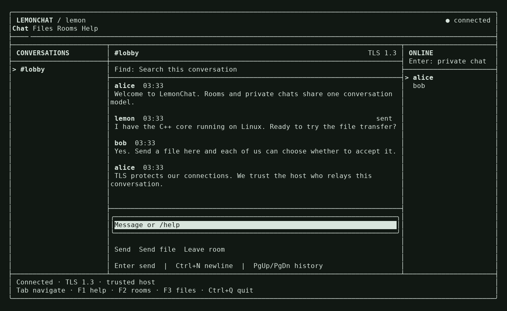

# LemonChat

A C++17 terminal chat application for Linux, macOS, and Windows. Create a server
from the TUI or run a dedicated server, then invite people into rooms and private
conversations. Qt and the original UDP implementation have been replaced.

- Full-screen conversation list, timeline, online members, per-conversation drafts,
  unread counts, history search, and transcript export.
- Public rooms with explicit membership; private conversations with two members.
- File offers to a person or a room. Each recipient accepts or declines separately.
  Progress, cancellation, SHA-256 verification, and no-overwrite file publication.
- TLS 1.3, certificate fingerprint pinning, and a private invitation secret.
- Asynchronous networking, bounded queues, binary file streaming, and a joined
  background event loop. Application code is C++; Python is only used for tests.



**Trust model:** the server is trusted and can read the messages and files it
relays. TLS protects each client-to-server connection; this is **not end-to-end
encryption** against the host. Share invitations through a trusted channel.

## Build

You need a C++17 compiler, CMake 3.16+, and OpenSSL 3 development libraries.
The initial configure downloads pinned, SHA-256-checked versions of
[FTXUI 7.0.3](https://github.com/ArthurSonzogni/FTXUI),
[standalone Asio 1.36.0](https://think-async.com/Asio/), and
[nlohmann/json 3.12.0](https://github.com/nlohmann/json).

Linux (Debian/Ubuntu):

```sh
sudo apt install build-essential cmake libssl-dev
cmake -S . -B build -DCMAKE_BUILD_TYPE=Release -DBUILD_TESTING=OFF
cmake --build build --parallel
./build/lemonchat
```

macOS:

```sh
brew install cmake openssl@3
cmake -S . -B build -DCMAKE_BUILD_TYPE=Release -DBUILD_TESTING=OFF \
  -DOPENSSL_ROOT_DIR="$(brew --prefix openssl@3)"
cmake --build build --parallel
./build/lemonchat
```

Windows: use Visual Studio 2022's C++ tools, CMake, and an x64 OpenSSL 3 developer
installation. From PowerShell:

```powershell
cmake -S . -B build -A x64 -DBUILD_TESTING=OFF '-DOPENSSL_ROOT_DIR=C:/Program Files/OpenSSL'
cmake --build build --config Release --parallel
$env:PATH = 'C:\Program Files\OpenSSL\bin;' + $env:PATH
.\build\Release\lemonchat.exe
```

Use Windows Terminal or another UTF-8 terminal. A window of at least 100 × 30 is
recommended; the member pane appears at 110 columns. At narrower sizes use `/dm`
and the Rooms tab. Linux/macOS binaries depend on the installed OpenSSL libraries;
Windows CI artifacts include the OpenSSL DLLs (the Visual C++ runtime is required).

## Start chatting

Run `lemonchat` without arguments for the launch form. Choose a nickname and
create or join a server. Tab moves between controls; arrow keys select entries.

To host on your LAN:

```sh
lemonchat host --name lemon --advertise 192.168.1.20 --port 4567
```

Open **Help** (F1) for the server invitation. Send that invitation privately to
participants. They can paste it into the launch form, or run:

```sh
lemonchat join --name alice --invite 'lemonchat://HOST:PORT?pin=…&key=…'
```

To run a separate server:

```sh
lemonchat serve --bind 0.0.0.0 --advertise chat.example.com --port 4567
```

The server prints a JSON `ready` event with its invitation. It shuts down on
SIGINT/SIGTERM. `--ready-file PATH` additionally writes this event to a new file.
`--port 0` selects a free port, useful for tests. `--advertise` controls the address
in invitations, while `--bind` selects the local listening IP. IPv6 is supported.

The host must be reachable from each participant. Open the listening TCP port in
the firewall; Internet hosting may require router forwarding or a reachable VPS.
There is no automatic NAT traversal. All private and room traffic uses this same
server; direct P2P connections are not part of this version.

## Interface

| Key | Action |
| --- | --- |
| Tab / Shift+Tab | Move focus between controls |
| Enter | Send the composed message or activate a control |
| Ctrl+N | Insert a newline in the composer |
| Ctrl+L / Ctrl+F | Focus composer / conversation search |
| PageUp / PageDown | Scroll message history |
| F1 / F2 / F3 | Help / Rooms / Files |
| Ctrl+Q | Exit and clean up active transfers |

Select a conversation on the left; select an online member on the right and press
Enter to open a private conversation. Rooms can be created and joined on the
Rooms tab. The Files tab has Accept, Save as, Decline, and Cancel controls.

The composer also accepts commands:

```text
/room NAME             Create and join a public room
/join NAME             Join a room
/dm NAME               Open a private conversation with an online member
/leave                 Leave the current room
/send PATH             Offer a file to the current conversation
/accept ID [PATH]      Accept a file (ID prefixes are supported)
/decline ID            Decline an offer
/cancel ID             Cancel an outgoing offer or active transfer
/search TEXT           Search this conversation's local history
/save PATH             Export this conversation as plaintext JSON
/reconnect             Reconnect after disconnection
/files  /rooms  /help  /quit
```

Paths may contain spaces and Unicode; optional surrounding double quotes are
removed. Incoming files default to the data directory's `downloads` subdirectory;
use `--downloads PATH` or **Save as** to choose another location. Existing files,
including symlinks, are never replaced. A `.lemonchat-*.part` file is published
only after size and SHA-256 verification and is removed on cancellation or normal
disconnection. POSIX publication requires a filesystem that supports hard links.
A forced process kill or power loss may leave a temporary file for manual cleanup.

## Persistence and limits

The default data directory is `$XDG_DATA_HOME/lemonchat` or
`~/.local/share/lemonchat` on Unix, and `%LOCALAPPDATA%/LemonChat` on Windows.
Override it with `--data-dir PATH`. `host/identity.json` contains the private TLS
key and invitation secret; preserve it to keep invitations valid. Unix identity
files use mode 0600 and their directory mode 0700. Windows uses the user's directory
ACLs. Never publish this file or an invitation in a public log.

Generated certificates expire after three years. To rotate an identity, stop the
server, move its `host/identity.json` to a secure backup, restart, and distribute
the new invitation. Old invitations will no longer work.

Message history is in memory, capped at 2,000 messages and 8 MiB of message text
across conversations. Use `/save` before exiting if you need a transcript. Exports
and received files are plaintext on disk. The server does not retain chat history
or store file contents. Reconnecting creates a new session: rejoin rooms and
reopen private conversations. Offline delivery, transfer resumption, accounts,
voice/video, and end-to-end group encryption are not implemented.

Messages are limited to 16 KiB; nicknames and room names to 48 UTF-8 bytes without
spaces. File size defaults to 1 GiB (`--max-file BYTES` on server/client). Server
capacity defaults to 64 simultaneous connections (`--max-clients`, maximum 1024),
with 256 conversations and 128 active file transfers. This is a configurable
resource limit, **not a claim of tested capacity**. A client can have eight pending
outgoing offers and eight active/pending incoming files. Transfers use 64 KiB
chunks, a 512 KiB window per transfer, and a 1 MiB aggregate sender window.
Per-connection output queues are capped at 8 MiB; slow peers are disconnected.
Membership changes that would exceed the bounded state-frame size are rejected.

`sent` means the server accepted the message. It does not mean anyone read it.
File `complete` requires the recipient's final acknowledgement after publication.
If that acknowledgement is lost, an already verified saved file is preserved.
Do not modify source files while sending; size changes abort the transfer, while
same-size in-place changes are not guaranteed to be detected.

## Testing and automation

```sh
python3 -m pip install -r tests/requirements.txt
cmake -S . -B build -DBUILD_TESTING=ON
cmake --build build --parallel
cd build
ctest --output-on-failure
```

On Windows add `--config Release` to the build and `-C Release` to CTest. Terminal
PTY tests run on Linux/macOS; the core and independent TLS integration tests run
on all three platforms. CI also runs AddressSanitizer and UndefinedBehaviorSanitizer.
Tests include multiple recipients, malformed peers, changed source files, Unicode
paths, consent, cancellations, and a 64 MiB transfer while chatting.

For automation, `host --headless` and `join --headless` read JSON commands from
stdin and write JSON events to stdout, using the same client core as the TUI.
`{"type":"quit"}` or EOF shuts the client down. See [the protocol](docs/PROTOCOL.md)
and [integration tests](tests/integration.py) for examples. Invitations passed in
arguments may be visible in process listings or shell history; the launch form
avoids that exposure.

## License

Apache-2.0. Dependency notices are in [docs/third-party](docs/third-party).
